# Three Kingdoms Card Battle Simulator

A Kotlin/JVM console simulation of a hidden-role, turn-based card battle. Players take the roles of a Lord, Loyalists, Rebels, or a Spy; draw and play cards; react to attacks; and use general-specific abilities as the game proceeds through turns until a side wins.

The project demonstrates object-oriented design and several software design patterns through a playable game engine. Its output is text-based, with the screenshots below showing sample game events and the implementation diagrams.

## At a glance

- **Language:** Kotlin
- **Build:** Gradle
- **Entry point:** `game.MainKt` in [`src/main/kotlin/game/Main.kt`](src/main/kotlin/game/Main.kt)
- **Player counts:** 4–8, with role compositions defined in `GeneralManager`
- **Game output:** Console log of setup, card creation and play, skills, judgments, attacks, and results

## Gameplay and features

- **Roles and generals:** Creates a Lord and supporting players with roles such as Loyalist, Rebel, and Spy. Role composition changes with the player count.
- **Cards and deck:** Builds a configured, shuffled deck of Attack, Dodge, Peach, delayed spell, Duel, and equipment cards.
- **Turns and win conditions:** Runs turns for living players, processes game events, and checks for Lord-side, Rebel-side, or Spy victories.
- **Combat and distance:** Selects targets according to a role strategy and checks circular seating distance, attack range, and horse equipment.
- **Skills and reactions:** Handles turn-start and attack-related skills, including Entourage, Benevolence, and Beauty.
- **Judgment and commands:** Resolves effects such as Lightning and Acedia at judgment time, and supports immediate Duel actions.
- **Health states:** Changes Liu Bei's play behavior based on whether he is healthy or below the health threshold.

## Design patterns in the project

| Pattern | How it is used |
| --- | --- |
| **Factory Method** | `CardFactory` creates concrete cards from configured card specifications; general factories create players. |
| **Observer** | Skills react to game events, and the Spy observes events from the Lord. |
| **Command** | Card effects are represented as commands, including delayed judgment effects and Duel. |
| **Strategy** | Role-specific strategies choose attack targets. |
| **State** | Liu Bei's behavior changes between healthy and unhealthy states. |

## Screenshots

The following examples are taken from the feature implementation documentation and demonstrate the range of console behavior implemented in the project.

| Game setup and card creation | Attack, Dodge, and Duel |
| --- | --- |
| 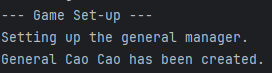 | 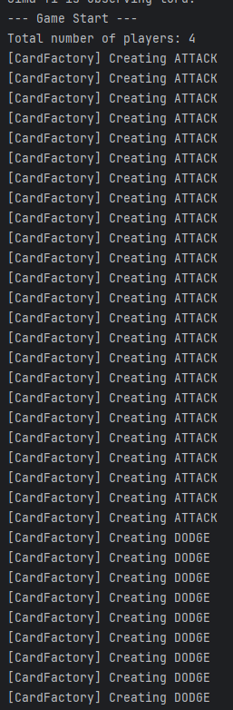 |
| 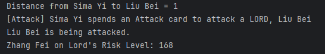 | 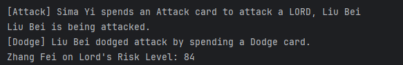 |
| 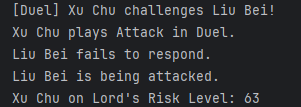 | 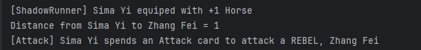 |

| Skills and player behavior | Turns, judgment, and state changes |
| --- | --- |
| 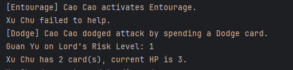 | 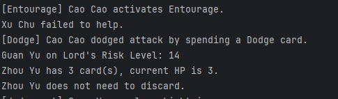 |
| 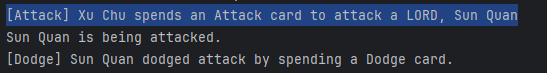 | 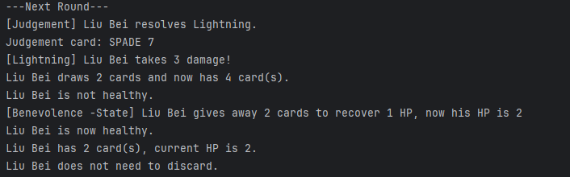 |

## Architecture diagrams

The diagrams below show the main game flow and the relationships behind the patterns and systems.

| Game engine | Card factory and deck |
| --- | --- |
| 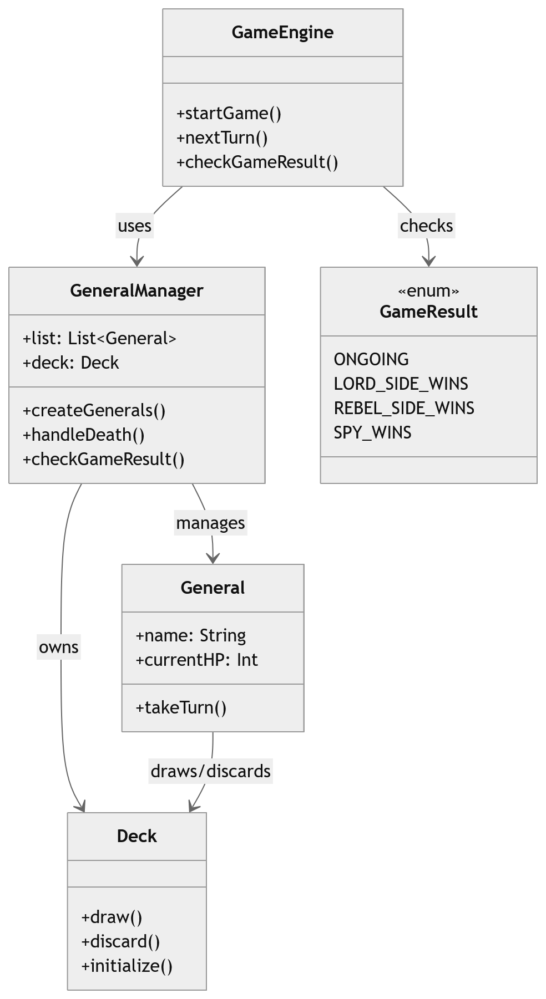 | 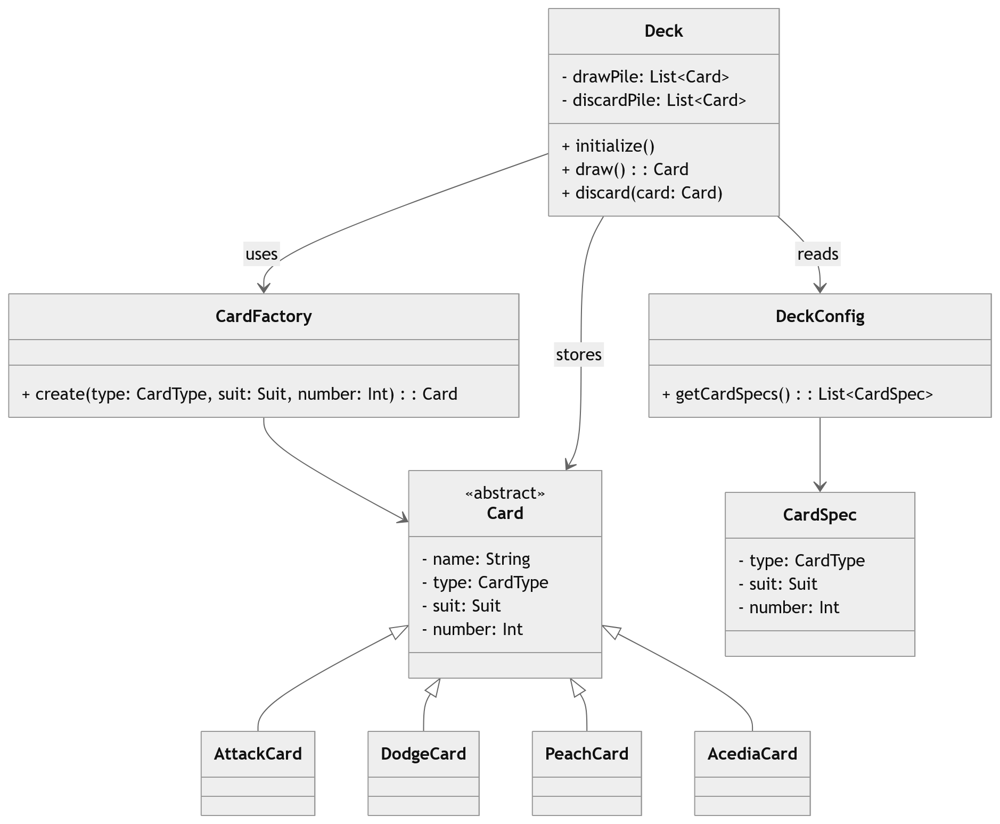 |

| Command-based card effects | Role-based attack strategy |
| --- | --- |
| 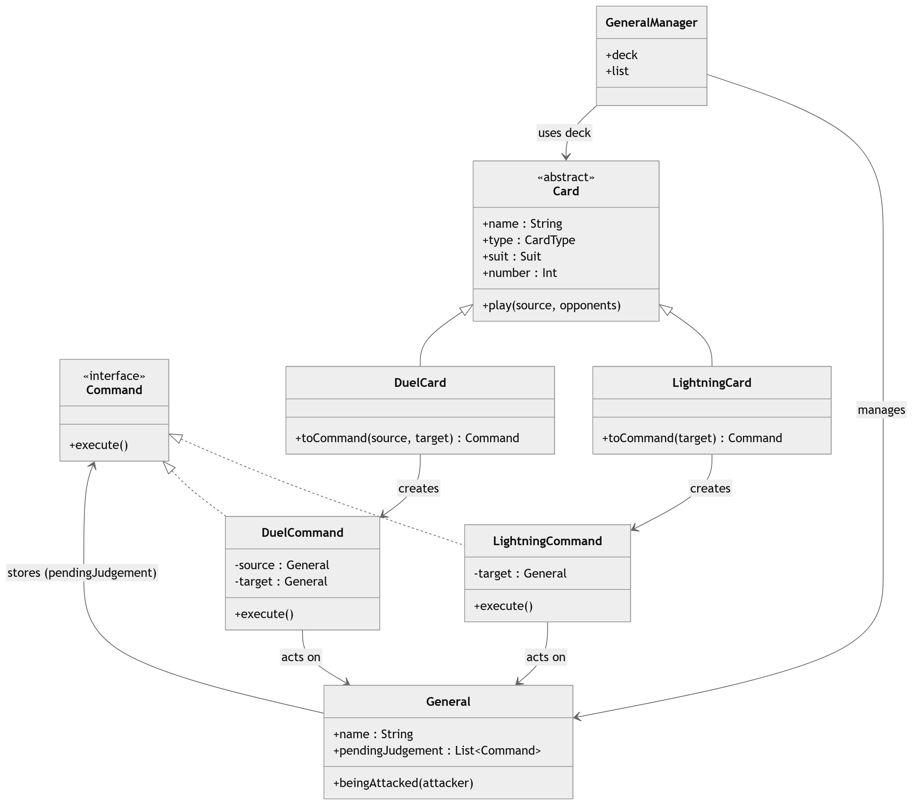 | 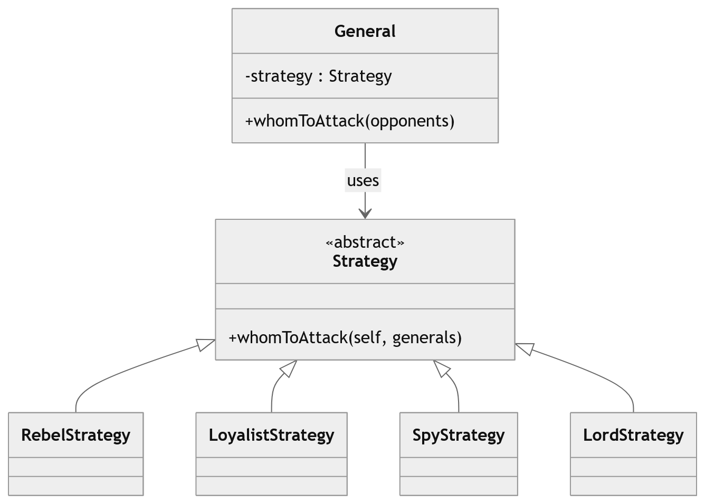 |

| Skill system | Health state system |
| --- | --- |
| 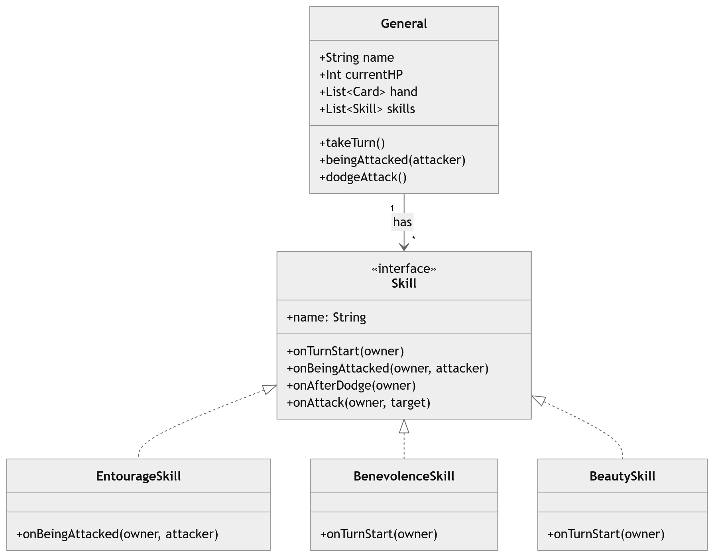 | 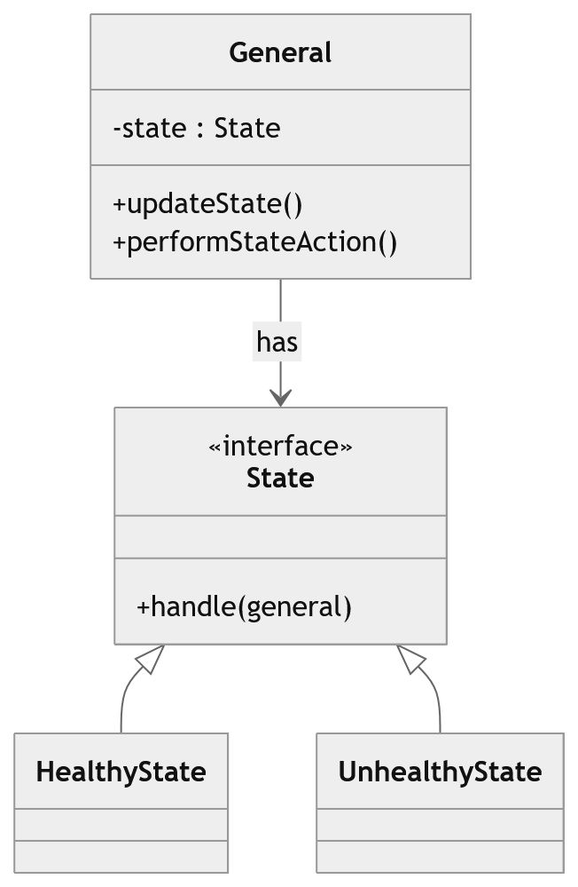 |

## Getting started

### Requirements

- IntelliJ IDEA with the Kotlin plugin
- A JDK installed and configured in IntelliJ. The Gradle build targets JVM 8; the project instructions recommend JDK 22 (Oracle JDK 22 or OpenJDK 22.0.1) if Gradle reports a Java configuration error.

### Run the game in IntelliJ IDEA

1. Open this project directory in IntelliJ IDEA and allow Gradle to import the project.
2. If prompted, select a configured JDK. Use JDK 22 if you encounter the Java/Gradle configuration issue noted in [`Instructions.md`](Instructions.md).
3. Open [`src/main/kotlin/game/Main.kt`](src/main/kotlin/game/Main.kt).
4. Run the `main` function. The game creates four players by default and prints the simulation to the Run console.

### Build and test

On Windows:

```powershell
.\gradlew.bat build
```

On macOS or Linux:

```shell
./gradlew build
```

The project currently has no configured Gradle `run` task; launch the `main` function from IntelliJ IDEA.

## Project structure

```text
src/main/kotlin/
+-- cards/          Card types, factory, deck configuration
+-- equipment/      Equipment card commands
+-- game/           Deck, game engine, and main entry point
+-- skills/         General skills and skill hooks
+-- spells/         Command interface and card-effect commands
+-- *.kt            Generals, roles, strategies, states, and managers

feature-impl-docs/
+-- report.md       Detailed feature explanations and design notes
+-- *.png           Sample console output and UML diagrams
```

## Feature implementation report

For implementation details, code excerpts, and the complete design discussion, see the [feature implementation report](feature-impl-docs/report.md). It covers the card factory and deck, skills, game engine, command-based effects, distance and horses, role strategies, and health states.
